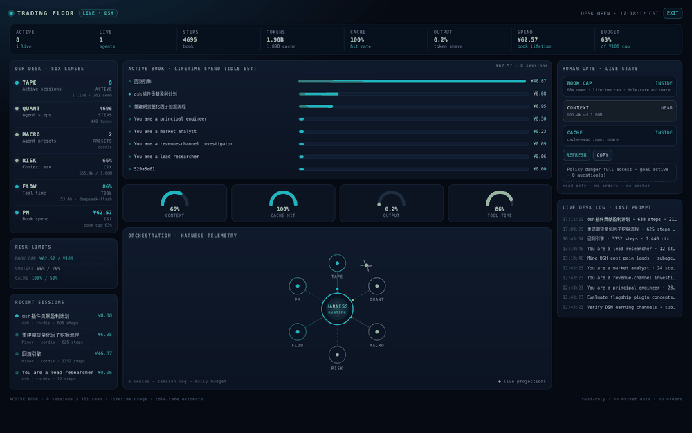

# DSH Trading Floor (P2)

A live, read-only trading-floor dashboard for **DeepSeek Harness itself**.



It turns the Session projections the Web UI already maintains into a desk view: active sessions, steps, token mix, cache hit, context pressure, tool time, per-session book bars, and a human risk gate. The visual language is a trading terminal; the data is DSH's own session telemetry.

**No market data. No broker. No orders. No external network calls.**

## What is real

- Sessions with a prompt today (or running) and their projections
- Per-session steps, turns, LLM time, and tool time
- Cache-read, uncached-input, and output tokens
- Context pressure and context window
- Agent preset and model selection
- A per-session lifetime cost estimate at DeepSeek's **idle** rates
- Subagent labels and last-prompt activity

The dashboard polls the same same-origin Session RPC the Web UI uses, every 10 seconds. A snapshot renders in roughly 0.4–0.6 seconds on a 361-session corpus.

## Scope and honesty

The Session projection exposes **lifetime** token usage per session, not call timestamps. The dashboard therefore calls its scope the **active book**:

- A session is in the book if its last prompt is today, or it is currently running.
- Spend is the **lifetime** cost of those book sessions at idle rates.
- It is **not** today's bill. For exact daily accounting use `dsh-token-audit`.

The UI labels this everywhere: `BOOK LIFETIME`, `IDLE EST`, `EST`, `BOOK CAP`, and `read-only`. The ¥100 cap is a policy guard, not a daily bill. There are no fake P&L numbers or invented agents.

## Screens

- **Ticker**: active, live, steps, tokens, cache, output share, book spend, book cap
- **Six lenses**: TAPE (sessions), QUANT (steps), MACRO (presets), RISK (context), FLOW (tool time), PM (book spend)
- **Gauges**: context, cache hit, output share, tool time
- **Orchestration web**: the harness at the center, six lenses around it
- **Human gate**: book cap (default ¥100 lifetime), context, and cache checks, with Refresh / Copy
- **Desk log**: last-prompt and subagent activity
- **FULL DESK**: full-viewport portal; Esc or EXIT returns to Settings

## Install

Use the Plugin Manager (`Plugins → Add plugin`) or the `plugin_manager` `install_bundle` action with this absolute directory. Once the public repo exists:

```bash
dsh plugin --profile web add github:lengrufeng2008/dsh-trading-floor
```

Open **Settings → Trading Floor**. `FULL DESK` is in the top-right.

The live profile install is a local link, so client edits apply after a page refresh. A packed tarball is produced with `npm pack` and can be attached to a GitHub Release.

## Verification

- `npm test`: 4/4 pure projection-fold tests
- Live Web UI: 1600×1000 and 1920×1080, 0 page errors, 0 console errors
- First data render: ~0.4–0.6 s
- Full-desk portal, Escape isolation, responsive Settings pane
- Read-only controls only: Refresh and Copy
- Fresh temp profile: installed the packed tarball with
  `dsh plugin --profile web add dsh-trading-floor-0.2.0.tgz`; `--dump-config` composed the
  `trading-floor` row; the Plugins page listed **Trading Floor** with the locale description
- Reviewer file tour: [`REVIEW.md`](REVIEW.md)

Screenshots: `docs/settings-1600.png`, `docs/full-desk-1600.png`, `docs/full-desk-1920.png`.

## Limits / next

- Exact daily bill needs event timestamps or a Host `wire.view`; P2 intentionally stays on the already-maintained projection API.
- Approval actions are not wired; the human gate reports live policy, goal phase, and pending questions.
- Market data and paper trading are deliberately out of scope.

## Compatibility

DSH `0.2.1-rc.2`, Web profile. The dashboard depends on the `session/list` client RPC and the `settings.section` slot.

MIT. The Grok Bot six-agent desk is a public use case; no code or assets were copied.
