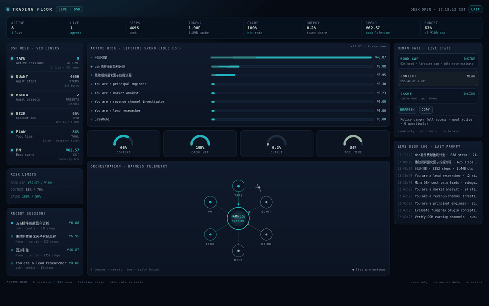

# DSH Trading Floor — showcase notes

## One paragraph

A trading-floor view of your own DSH desk. It reads the Session projections the Web UI already keeps, so the ticker, six lenses, gauges, book bars, and human gate are all live DSH data: active sessions, steps, cache/input/output tokens, context pressure, tool time, and a book-lifetime spend estimate. It is read-only, client-only, and makes no external calls.

## Why it is relevant to the DSH team

- It is built entirely on two existing extension points: the `settings.section` slot and the `session/list` client RPC.
- It turns the harness's own projections into an operational surface without adding a Host route, a database, or a build step.
- It demonstrates a non-trivial plugin UI (responsive, full-viewport portal, live polling) with zero runtime dependencies.

## 30-second demo

1. Open **Settings → Trading Floor**.
2. Point at **ACTIVE / LIVE / STEPS / TOKENS / CACHE** in the ticker.
3. Point at the six lenses and the **BOOK CAP / CONTEXT / CACHE** gate.
4. Press **FULL DESK**, then **EXIT** (or Esc).
5. Say the honest limitation: the projection exposes lifetime usage, so spend is an idle-rate estimate and the scope is the active book; exact daily billing is `dsh-token-audit`.

## Honest boundaries

- No market data, no broker, no orders.
- Book = sessions whose last prompt is today, or running; spend = lifetime of those sessions at idle rates.
- No prompt/response text is shown; logs are session titles, step counts, context size, and subagent labels.
- All data stays in the local Web origin.

## Links

- Repo (after creation): `https://github.com/lengrufeng2008/dsh-trading-floor`
- Screenshots: `docs/full-desk-1600.png`, `docs/settings-1600.png`
